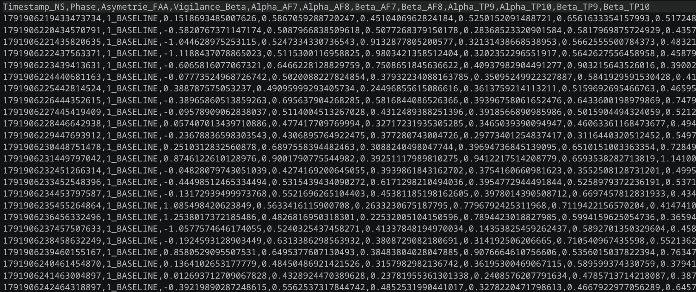

# 🔬 Synchro-Affect : Évaluation neuroadaptative du stress par asymétrie frontale EEG

[](https://www.python.org/downloads/)
[](https://brainflow.org/)
[-darkblue.svg)](https://www.devinci.fr/ift/)

Ce projet implémente un pipeline complet d'**informatique affective** de niveau recherche universitaire. Il permet de déployer une expérience automatisée de stress réactif de 5 minutes, d'acquérir les signaux EEG en temps réel à l'aide du bandeau **Muse S Athena**, puis d'en extraire une validation statistique rigoureuse.



---

## 1. Fondements théoriques & objectifs

L'objectif majeur de ce protocole est de démontrer graphiquement et statistiquement une **double dissociation** neurophysiologique :
1. **La Charge Mentale (Phase 2)** active le cortex (hausse de la vigilance cognitive) mais maintient l'équilibre émotionnel (Asymétrie stable proche de 0.0).
2. **Le Stress Réactif (Phase 3)** rompt l'équilibre inter-hémisphérique, provoquant une activation préfrontale droite asymétrique liée aux mechanisms de défense, de menace et d'évitement.

### Les indicateurs neuroquantitatifs mesurés
*   **L'Index FAA (Asymétrie Frontale Alpha)** : Calculé via la formule ln(Alpha Droit) - ln(Alpha Gauche) sur les canaux frontaux (**AF7** / **AF8**). Une valeur proche de 0 indique un état neutre ou concentré. Une chute profonde sous la barre des `-0.25` signe une réaction de stress aigu.
*   **La Vigilance Beta** : Mesure l'activation cognitive globale sur le cortex préfrontal. Elle augmente drastiquement lors d'un effort intellectuel (ex: calcul mental).

---

## 2. Architecture du protocole expérimental (300 secondes)

L'expérience est entièrement automatisée par le script d'acquisition et se découpe en 4 phases chronologiques strictes :

```
       0s            60s                     150s              210s              300s

       |--------------|-----------------------|-----------------|------------------|
   BASELINE     CHARGE MENTALE          STRESS RÉACTIF       RECOVERY / RETOUR
    (60s)            (90s)                   (60s)               AU CALME (90s)
```

*   **Phase 1 : Baseline (0 à 60s)** : Enregistrement de l'activité cérébrale de référence au repos (Audio de vagues calmes, yeux fixés sur l'écran).
*   **Phase 2 : Charge Mentale (60 à 150s)** : Stimulation cognitive intense sans menace émotionnelle (Calculs mentaux complexes ou test de Stroop).
*   **Phase 3 : Stress Réactif (150 à 210s)** : Rupture brutale induite par un stimulus perturbateur surprise à la 150e seconde précise (Alarme stridente à 85 dB ou stimulus visuel de menace).
*   **Phase 4 : Recovery (210 à 300s)** : Observation de la résilience neuronale et du retour au calme (Guide respiratoire visuel de cohérence cardiaque).

---

## 3. Structure du projet

```text
experience_eeg/
├── .gitignore                      # Configuration pour exclure .venv et les fichiers *.csv
├── README.md                       # Documentation principale du projet
├── experiment_lab.py               # Script d'acquisition EEG en temps réel (BrainFlow)
├── analyse_stats.py                # Pipeline d'analyse statistique, t-test et graphiques
│
├── doc/                            # Guides méthodologiques et d'interprétation
│   ├── BRIEFING_UTILISATEUR.md     # Consignes physiques et droit d'arrêt du sujet
│   ├── manuel_analyse.md           # Guide d'interprétation des courbes FAA et Beta
│   └── manuel_experience.md        # Protocole Synchro-Affect et déroulement des phases
│
├── img/
│   └── result.png                  # Le graphique 300 DPI affiché dans ce README
│
└── Ressources Expérience 1/        # Stimuli multimédias diffusés pendant le test
    ├── Phase_1.mp4                 # Baseline (Vagues calmes)
    ├── Phase_2.mp4                 # Charge Mentale (Calculs itératifs)
    ├── Phase_3_1.mp4               # Stress Réactif (Déclenchement du stimulus de sursaut)
    ├── Phase_3_2.mp4               # Stress Réactif (Vidéo ou compte à rebours de menace)
    └── Phase_4.mp4                 # Recovery (Cohérence cardiaque guidée)
```

---

## 4. Installation & Configuration

### Prérequis matériel
* Bandeau **Muse S (Génération 3 / Variante "Athena")** chargé.
* Un ordinateur équipé d'une carte Bluetooth compatible BLE 5.0+.

### Dépendances python
Installez les bibliothèques requises à l'aide du gestionnaire de paquets :
```bash
pip install brainflow numpy pandas matplotlib seaborn scipy
```

---

## 5. Guide d'exécution

### Étape 1 : Recueil du consentement & briefing
Avant toute manipulation, faites lire et signer au participant le **Formulaire de Consentement**. Vérifiez impérativement les critères d'exclusion (épilepsie photosensible, troubles cardiaques sévères, hyperacousie).

### Étape 2 : Acquisition des données (experiment_lab.py)
1. Ajustez le bandeau sur la tête du participant (électrodes en silicone **AF7/AF8** bien en contact avec la peau, juste au-dessus des sourcils).
2. Modifiez l'adresse MAC de votre Muse S à la fin du fichier `experiment_lab.py`.
3. Lancez le script d'acquisition :
```bash
python experiment_lab.py
```
Le programme va streamer les données, appliquer des filtres physiologiques (Passe-bande 2-35 Hz + Coupe-bande Notch à 50 Hz pour le réseau électrique), et enregistrer une ligne de télémétrie par seconde dans un fichier `.csv` horodaté.

### Étape 3 : Analyse et validation (analyse_stats.py)
Une fois les 300 secondes écoulées, lancez le pipeline statistique :
```bash
python analyse_stats.py
```
Le script va automatiquement détecter le fichier de session le plus récent, calculer les métriques et afficher le rapport dans votre terminal.

---

## 6. Décoder les résultats du rapport statistique

Le script d'analyse génère deux livrables majeurs pour valider ou rejeter vos hypothèses de recherche :

### A. Le Rapport console
*   **Moyennes et Écarts-types** : Permettent de quantifier la stabilité du sujet et l'amplitude de sa réponse émotionnelle.
*   **Test T de Student (Inférence Statistique)** : Compare la phase de Baseline et la phase de Stress Réactif. Si la valeur **P-Value est inférieure à 0.05**, la baisse de la FAA is statistiquement significative et votre expérience est scientifiquement validée.
*   **Indicateur de Résilience Affective** : Calcule le pourcentage de récupération du sujet en phase 4 par rapport à son état initial.

### B. Le Graphique Bi-Volet (img/result.png)
*   **Volet Supérieur (Index FAA - Courbe Violette)** : Doit rester stable et proche de la ligne `0.0` en phases 1 et 2, s'effondrer profondément dans les valeurs négatives en phase 3 (Stress), puis entamer une remontée progressive en phase 4.
*   **Volet Inférieur (Vigilance Beta - Courbe Orange)** : Doit dessiner une marche d'escalier ascendante franche dès le début de la phase 2, matérialisant l'effort d'attention focalisée.

---

## 7. Diagnostics et résolution des problèmes

*   **L'index FAA fait de grands bons chaotiques** : Le sujet bouge la tête ou cligne excessivement des yeux. Demandez-lui de fixer calmement le centre de l'écran et de relâcher sa mâchoire.
*   **L'index FAA reste négatif durant TOUTE l'expérience** : Problème d'asymétrie de contact physique. Nettoyez le front du participant et repositionnez le bandeau pour vous assurer que les deux capteurs gauches et droits touchent uniformément la peau.
*   **La courbe temporelle présente des trous** : Des paquets Bluetooth ont été perdus. Éloignez les autres appareils sans fer émettant à proximité (smartphones) pour purifier le flux BLE.
